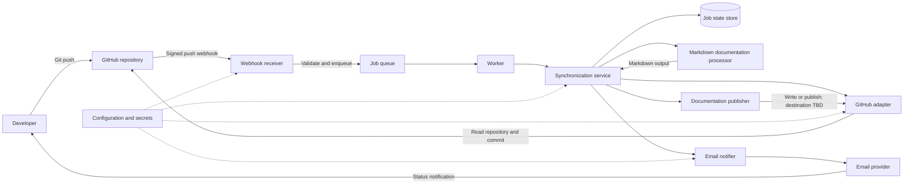

# Automated Documentation Sync: High-Level Architecture

## Architecture Overview

The solution receives Git push events from GitHub, processes the affected repository through a synchronization workflow, maintains Markdown documentation, and sends email notifications to developers. The design below is a proposed baseline. GitHub, Markdown, push-triggered processing, and email are requirements; implementation and deployment technologies beyond those are recommendations pending confirmation.

## Components

| Component | Responsibility |
| --- | --- |
| GitHub repository | Stores source code and Markdown documentation; emits push events. |
| Webhook receiver | Accepts GitHub push webhooks, verifies the webhook signature, validates the event, and records/enqueues accepted work. |
| Job queue and worker | Processes accepted events asynchronously, supports retries, and avoids losing work when the receiver is restarted. |
| Synchronization service | Coordinates a synchronization job, loads repository configuration, invokes documentation processing, records the outcome, and requests notifications. |
| GitHub adapter | Reads repository content and commit metadata and, if required, publishes updated Markdown through the GitHub API. |
| Markdown documentation processor | Selects and generates or updates Markdown content according to configured rules, then validates the output. |
| Email notifier | Sends configured success or failure notifications to developers through an email provider. |
| Job state store | Tracks processed webhook/event identifiers and job status to support deduplication, retries, and operational review. |
| Configuration and secrets | Holds repository settings, notification recipients, webhook secrets, and GitHub/email credentials outside source control. |

## Technology Stack

| Area | Proposed technology | Status |
| --- | --- | --- |
| Repository and event source | GitHub repository and GitHub Webhooks (`push` event) | Required by current requirements |
| Application language | Python | Recommended; aligns with the existing `src/` module layout |
| Webhook/API layer | FastAPI | Proposal; framework not specified |
| Repository integration | GitHub REST API over HTTPS, using a least-privilege GitHub App or token | Proposal; auth method not specified |
| Documentation format | Markdown | Required by current requirements |
| Background processing | Durable task queue and Python worker | Recommended; queue product not specified |
| State persistence | Small relational database for event IDs and job status | Recommended; persistence requirements not yet defined |
| Email delivery | Email provider API or SMTP through an adapter | Email is required; provider and protocol are not specified |
| Deployment and secrets | Managed application runtime/container and a secrets manager | Deployment platform not specified |

## Data Flow

1. A developer pushes a commit to the configured GitHub repository.
2. GitHub sends a signed `push` webhook to the webhook receiver.
3. The receiver verifies the signature and event, rejects invalid requests, and enqueues valid events. It records an event identifier so webhook redelivery can be handled idempotently.
4. A worker passes the event to the synchronization service, which obtains the repository and commit details through the GitHub adapter.
5. The Markdown documentation processor applies the configured synchronization rules and validates the resulting Markdown.
6. If documentation must be written or published, the publisher uses the GitHub adapter to deliver the output to the configured destination. The destination and whether updates are committed directly, placed on a branch, or opened as a pull request remain undecided.
7. The synchronization service records success or failure and asks the email notifier to send the applicable notification to configured developer recipients.
8. Transient processing or delivery failures are retried according to configured limits; final failures are recorded and reported by email.

## Component Responsibilities

- **Webhook receiver:** Authenticate GitHub requests, validate event type and payload, acknowledge accepted events promptly, and prevent untrusted requests from starting jobs.
- **Queue and worker:** Separate webhook delivery from longer processing, provide controlled retries, and process duplicate deliveries safely.
- **Synchronization service:** Own workflow coordination and outcome handling; avoid embedding GitHub API, Markdown transformation, or email-provider details in orchestration logic.
- **GitHub adapter:** Encapsulate GitHub API calls, permissions, rate-limit handling, and repository read/write operations.
- **Markdown documentation processor:** Keep documentation rules separate from transport and delivery; report validation errors without silently publishing invalid output.
- **Email notifier:** Format and send notifications for the configured outcomes; avoid exposing credentials or sensitive repository content in email.
- **Job state store:** Maintain event/job status and error summaries while limiting stored data to operational needs.
- **Configuration and secrets:** Provide per-repository rules and recipients; keep credentials encrypted and restrict access to the components that need them.

## Architecture Diagram

## Decisions To Confirm

- Which Markdown files or documentation categories are in scope?
- Does synchronization generate/update files in the repository, publish to another destination, or both?
- Should generated changes be committed directly, pushed to a bot branch, or submitted as a pull request?
- Which branches and push types trigger processing, and should bot-generated commits trigger a new run?
- Which email outcomes should be sent, and who are the recipients?
- What are the required availability, processing-time, retention, and recovery targets?
- Which hosting platform, queue, database, GitHub authentication method, and email provider should be used?
