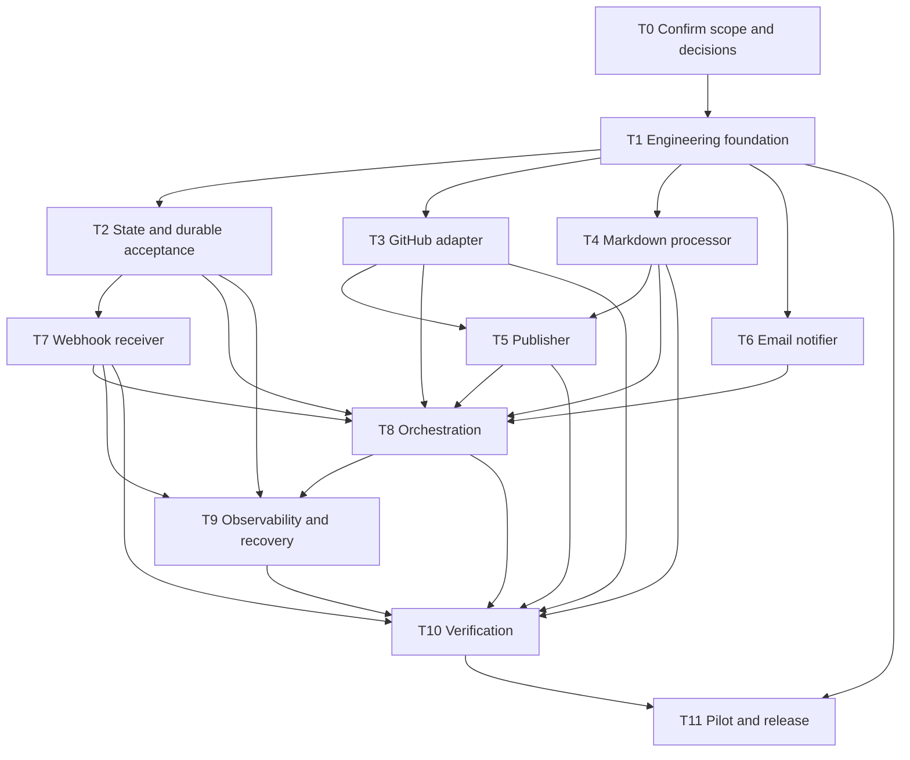

# Automated Documentation Sync: Implementation Plan

## Planning Basis

This plan follows the components and flow in [architecture.md](architecture.md). GitHub, Markdown, push-triggered synchronization, and email are confirmed constraints. Python, FastAPI, the queue, database, hosting platform, GitHub authentication approach, and email provider are proposed or unresolved choices; confirm them before committing to implementation-specific work.

Task IDs reflect a dependency order. Tasks with the same prerequisites can proceed in parallel.

## Tasks

### T0: Confirm scope and architecture decisions

**Depends on:** None  
**Work:** Confirm documentation files and rules; branches and push events; publication destination and method; bot-commit loop prevention; notification recipients and outcomes; measurable performance, availability, retention, and recovery targets; and selected technology/provider choices.  
**Deliverable:** Approved scope, decision record, and acceptance criteria.

### T1: Establish engineering and runtime foundation

**Depends on:** T0  
**Work:** Define module/configuration contracts, local development setup, CI checks, test conventions, environment configuration, secret injection, and initial runtime/deployment structure.  
**Deliverable:** Reproducible development environment and automated build/test pipeline.

### T2: Design job state and durable event acceptance

**Depends on:** T0, T1  
**Work:** Define job lifecycle/statuses, delivery-ID uniqueness, idempotency behavior, persistence schema, queue contract, retry/backoff policy, dead-letter handling, and per-repository ordering or coalescing. Choose an atomic acceptance pattern so a crash cannot silently lose work between persistence and enqueueing.  
**Deliverable:** Versioned persistence model and tested queue/state interfaces.

### T3: Implement GitHub adapter

**Depends on:** T0, T1  
**Work:** Implement least-privilege authentication, repository/commit reads, changed-file discovery, rate-limit handling, and the agreed write capability if publication targets GitHub.  
**Deliverable:** Tested adapter with permission and API error handling.

### T4: Implement Markdown documentation processor

**Depends on:** T0, T1  
**Work:** Implement configured file selection and generation/update rules; validate Markdown output and enforce file/path/size limits; keep processing separate from network and provider code.  
**Deliverable:** Deterministic processor with unit tests and invalid-output handling.

### T5: Implement documentation publisher

**Depends on:** T0, T3, T4  
**Work:** Implement the selected destination and delivery method, such as a GitHub bot branch or pull request. Enforce allowed paths, handle conflicts, and apply the agreed bot-trigger loop-prevention policy.  
**Deliverable:** Tested publisher that reports publication outcome and cannot write outside configured scope.

### T6: Implement email notifier

**Depends on:** T0, T1  
**Work:** Integrate the selected email provider, configure recipients and success/failure event rules, protect sensitive content, and define independent notification retry/failure handling.  
**Deliverable:** Tested notification adapter and message templates.

### T7: Implement secure webhook receiver

**Depends on:** T0, T1, T2  
**Work:** Receive GitHub push webhooks; validate signature, event type, repository/installation allowlist, and payload; deduplicate delivery IDs; durably accept valid jobs before acknowledgment; reject invalid requests.  
**Deliverable:** Tested webhook endpoint with replay, invalid-signature, duplicate, and durable-acceptance coverage.

### T8: Implement worker and synchronization orchestration

**Depends on:** T2, T3, T4, T5, T6, T7  
**Work:** Consume accepted jobs; fetch commit context; invoke processing and publishing; persist job outcomes; coordinate retries; and request notifications without coupling core workflow logic to provider implementations.  
**Deliverable:** End-to-end synchronization workflow for one configured repository.

### T9: Add operational observability and recovery controls

**Depends on:** T2, T7, T8  
**Work:** Add structured logs, correlation IDs, queue/job metrics, health checks, alerts for backlog/failure, dead-letter inspection and replay procedures, and retention controls. Avoid logging secrets or unnecessary repository content.  
**Deliverable:** Runbook-ready operational signals and recovery procedures.

### T10: Verify security, reliability, and acceptance criteria

**Depends on:** T3, T4, T5, T7, T8, T9  
**Work:** Run unit, integration, and end-to-end tests for valid/invalid webhooks, duplicate/out-of-order pushes, large changes, API/email outages, retries, publication conflicts, loop prevention, authorization boundaries, and the targets agreed in T0.  
**Deliverable:** Test evidence, resolved release-blocking defects, and acceptance sign-off.

### T11: Deploy pilot and release

**Depends on:** T0, T1, T10  
**Work:** Deploy to the selected managed runtime; configure GitHub webhook/app permissions, queue/database, secrets, email provider, alerts, and documented rollback; pilot against a low-risk repository before enabling the agreed scope.  
**Deliverable:** Approved production rollout with monitoring and rollback available.

## Dependencies

## Milestones

| Milestone | Includes | Exit criteria |
| --- | --- | --- |
| M0: Scope and design approved | T0 | Open choices affecting interfaces, security, and acceptance are decided and recorded. |
| M1: Foundation and component contracts ready | T1-T7 | Runtime/test foundation and independently testable persistence, adapter, processor, publisher, notifier, and webhook components are available. |
| M2: Integrated workflow complete | T8 | A valid push can be accepted, processed, published according to scope, and recorded with the correct outcome. |
| M3: Release candidate verified | T9-T10 | Security, failure recovery, loop prevention, and agreed non-functional acceptance criteria pass; runbook and operational signals are ready. |
| M4: Pilot and release complete | T11 | Pilot succeeds, rollback is verified, and rollout is approved. |

## Risks and Mitigations

| Risk | Impact | Mitigation / decision gate |
| --- | --- | --- |
| Documentation scope or publication target remains undecided | Interfaces and acceptance tests may need rework. | Resolve in T0 before implementation contracts are fixed. |
| Webhook is acknowledged but its job is not durably queued | Push work can be lost; replay may duplicate work. | Define atomic durable acceptance and delivery-ID idempotency in T2 and test failure windows in T7/T10. |
| Automation's own write-back triggers another run | Infinite or redundant synchronization and email loops. | Decide publishing mode and bot-trigger policy in T0; implement and test the policy in T5/T10. |
| Credentials are overprivileged or generated output writes outside intended paths | Unauthorized repository modification or exposure. | Use least-privilege credentials, path allowlists, protected branches/pull requests, and security tests in T3/T5/T10. |
| Concurrent jobs publish stale output | Latest documentation can be overwritten by an older job. | Establish per-repository ordering/coalescing and current-commit checks in T2/T8/T10. |
| GitHub API or email provider rate limits/outages disrupt processing | Delays, retries, or unreported outcomes. | Define bounded retries/backoff and independent notification retry handling in T3/T6/T8; observe backlog and failures in T9. |
| Scale and availability targets remain unspecified | Infrastructure may be under- or over-provisioned. | Set measurable targets in T0 and validate them in T10 before release. |
| Queue poison messages or repeated failures accumulate | Backlog growth and reduced worker capacity. | Configure bounded attempts, dead-letter handling, alerts, and replay procedures in T2/T9. |
